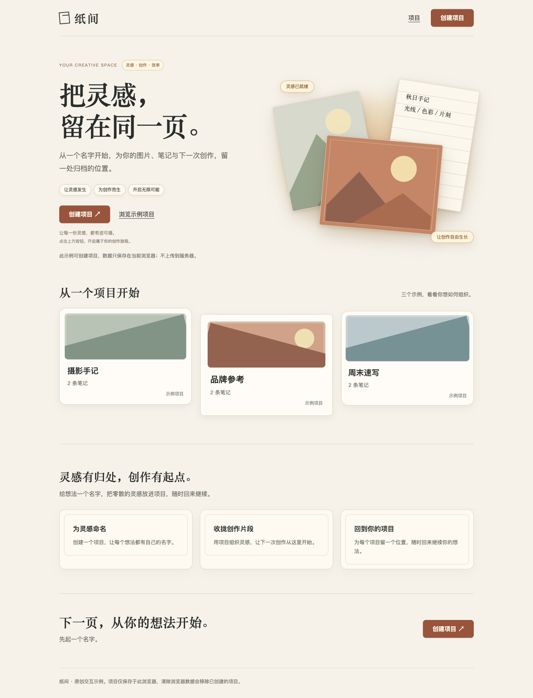

# 案例：精简「纸间」落地页

「纸间」是随 Skill 提供的原创交互示例。它采用暖纸色、宋体标题、赤陶色按钮和倾斜叠放的纸张插画，支持查看三个示例项目，以及创建保存在当前浏览器的项目名称。

这次优化保留视觉主题，整理重复表达、列表对齐和创建路径。原始页完整保留，两个版本都可以实际操作。

[在线体验原始页](https://haidarkhanuk3344-collab.github.io/FHX-backyard/skills/page-simplify/examples/before.html) · [在线体验精简后页面](https://haidarkhanuk3344-collab.github.io/FHX-backyard/skills/page-simplify/examples/after.html)

[原始页源码](before.html) · [精简后源码](after.html) · [返回使用说明](../README.md)

## 前后对照

桌面截图使用相同的 1440 × 1000 浏览器视口，均为完整页面。截图中的三个项目与内容一致。

| 原始页面 | 精简后页面 |
| --- | --- |
|  |  |

移动端截图使用 390 × 844 视口：[原始页面](before-mobile.png) / [精简后页面](after-mobile.png)。页面长度变化只是布局结果，验收仍以信息、操作和视觉表达是否完整为准。

## 如何执行

先完成原始页面，再把 [SKILL.md](../SKILL.md)、原始页面和精简任务交给一个不携带此前讨论的独立执行会话。执行会话自行判断保留与修改项，没有收到预设的删除清单。随后对生成的页面进行浏览器操作和截图检查。

本次补充案例没有修改 Skill 的核心规则。以下记录对应实际生成的两个 HTML 文件。

## 具体取舍

| 位置 | 问题 | 处理 | 理由 |
| --- | --- | --- | --- |
| 首屏口号 | 英文眉题、标签、标语和按钮说明反复表达“灵感与创作” | 删除重复小字，缩短正文 | 标题、下一步操作与本地保存说明已承担所需职责；删除内容不含独有功能事实 |
| 纸张插画 | 浮动口号、暖光和多层阴影同时吸引注意力 | 删除重复口号，减弱光晕和阴影 | 保留三张纸、山形插画、手记与倾斜叠放，继续表达纸间的视觉主题 |
| 顶部与首屏按钮 | 同一动作的两个实心按钮同时突出 | 顶部改为文字按钮，首屏保留赤陶色主按钮 | 两个入口都方便使用，调整视觉强度即可，无须因为动作重复而删除入口 |
| 项目列表 | 卡片的边距、圆角、字号与信息位置不一致 | 统一网格、标题基线和元数据位置，去掉多余外层容器 | 同职责的项目更容易比较；首屏有意的不对称构图继续保留 |
| 项目元数据 | 类型与笔记数量分散在两处 | 合并为一行 | 原有信息全部保留，减少来回扫视 |
| 创建路径 | 欢迎弹窗仅提供继续与取消，进入名称输入还需再次点击 | 直接打开名称表单 | 中间步骤没有独有的选择或风险提示职责；保留输入校验、取消和保存失败说明 |
| 卖点与收尾模块 | 再次复述命名、整理和创建行动 | 删除两个重复区块 | 核心信息与行动已在首屏和项目区呈现，没有独有决策信息随之删除 |
| 窄屏与长名称 | 固定字号、插画尺寸和卡片样式使小屏适配复杂 | 改为流动字号、相对尺寸、单列项目和长名称换行 | 保留内容与点击入口，弹窗允许内部滚动 |
| 能力边界与状态 | 精简可能连带隐藏限制和错误信息 | 保留本地保存、清除数据后果、未实现图片／笔记编辑的说明 | 页面承诺与实际能力保持一致；保存失败不会显示虚假的创建成功 |

## 浏览器验证

验证日期：2026-10-13。环境：本机 Chromium 浏览器，本地静态服务；另外检查了直接打开精简版 HTML 文件的创建与保存。以下结果只覆盖本例和当前测试环境。

| 检查项 | 结果 |
| --- | --- |
| 从首屏创建入口进入名称输入 | 原始版需点击两次；精简版点击一次直接进入表单 |
| 顶部与首屏创建入口 | 均可用，精简版打开后名称输入框获得焦点 |
| 空名称和长度限制 | 空名称显示错误并聚焦输入框；测试中输入限制为 24 个汉字 |
| 创建、刷新与再次查看 | 两版均通过；精简版正确显示新项目尚未提供图片和笔记编辑 |
| 示例项目 | 三个项目、每个两条静态笔记均可打开，内容与原版一致 |
| 取消、Escape 与焦点回归 | 精简版创建弹窗和详情弹窗可关闭，焦点返回触发入口 |
| 键盘导航 | 模态弹窗内可使用 Tab／Shift+Tab；未进入背景页面控件。浏览器允许反向导航到自身工具栏 |
| 保存失败 | 临时模拟本例存储写入失败后，弹窗保持打开并给出错误提示，列表不增加未保存项目 |
| 1440px 桌面与 390px 移动端 | 截图检查通过，无横向溢出；插画、主操作与项目信息保留 |
| 320px 窄屏 | 无横向溢出；24 个汉字的项目名可换行，详情弹窗在视口内 |
| 减少动态效果偏好 | 设置生效时，平滑滚动切换为直接滚动，按钮过渡为 0 秒 |
| 直接打开 HTML 文件 | 当前浏览器中可以创建项目并在刷新后读取；其他浏览器的文件存储策略可能不同 |

两个版本使用相同的本地存储键，部署在同一站点时可以读取同一批本地项目。它们保存本地项目的基本信息，不提供账户、跨设备同步、图片上传或笔记编辑。若浏览器拒绝保存，会显示失败提示。

## 这个案例说明什么

有意的倾斜构图、纸张层次和暖色氛围具有设计价值，得以保留；过强的阴影与光晕经过减弱；重复口号和没有独立作用的中间步骤被移除。相同职责的列表项统一对齐，不要求所有元素都变成规则网格。

这是一个原创演示案例，没有真实访客的转化率或可用性研究数据。它用于查看 Skill 的判断过程与实现结果，不代表其他页面一定能获得相同收益。
